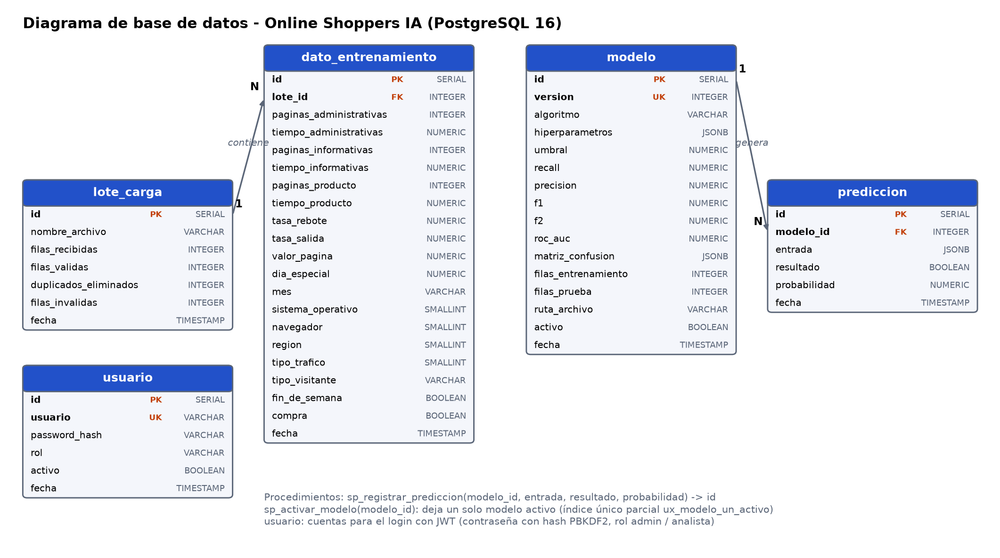

# Online Shoppers IA

Servicio de inteligencia artificial que predice si una sesión de navegación en una tienda online **termina en compra**. Incluye el entrenamiento del modelo siguiendo **CRISP-ML(Q)**, una **API REST** (FastAPI + Swagger), una base de datos **PostgreSQL** y una **aplicación web** que consume todos los endpoints.

Trabajo final · SIS-352

## Arquitectura

```
Jupyter (EDA + pruebas)  ──config_modelo.json──►  Servicio IA (FastAPI)
                                                    │      ▲
CSV / formulario ─► Cliente web  ◄── API REST JSON ─┘      │
                                                           ▼
                        PostgreSQL: lote_carga · dato_entrenamiento · modelo · prediccion
```

1. El cliente web envía un CSV → el servicio lo valida y limpia (tipos, filas inválidas, nulos, duplicados) → lo guarda en `dato_entrenamiento`.
2. `POST /retrain` entrena una nueva versión con los datos de la BD usando el algoritmo, los hiperparámetros y el criterio de umbral elegidos en el notebook, y guarda sus métricas en `modelo`.
3. `POST /predict` usa el modelo activo y guarda la entrada y el resultado en `prediccion`.

## Dataset y modelo

- **Dataset:** [Online Shoppers Purchasing Intention](https://www.kaggle.com/datasets/imakash3011/online-shoppers-purchasing-intention-dataset): 12 330 sesiones, 17 variables, objetivo `Revenue` (15,5 % compras).
- **Problema:** clasificación binaria supervisada.
- **Métrica:** Recall(compra) ≥ 70 % como requisito, F2 como métrica principal, ROC-AUC de apoyo.
- **Modelos comparados:** Regresión Logística, Árbol de Decisión, KNN, Random Forest y XGBoost.
- **Modelo elegido:** XGBoost (umbral 0,44).

| Recall (compra) | Precision | F1 | F2 | ROC-AUC |
|---|---|---|---|---|
| 0,893 | 0,504 | 0,644 | 0,773 | 0,939 |

## Cómo ejecutarlo

Requisitos: Docker Desktop y Python 3.13.

```bash
# 1. Base de datos (crea tablas y procedimientos con db/schema.sql)
docker compose up -d

# 2. Entorno de Python
python -m venv .venv
.venv\Scripts\activate            # Windows  (Linux/Mac: source .venv/bin/activate)
pip install -r api/requirements.txt

# 3. API
cd api
uvicorn main:app --port 8000
```

- Cliente web: http://localhost:8000/app/
- Swagger: http://localhost:8000/docs

Primer uso: en la pestaña **Datos de entrenamiento** suba `data/online_shoppers_intention.csv` y luego pulse **Reentrenar**. Ya puede predecir.

Para el notebook: `pip install -r requirements-notebook.txt` y abrir `notebooks/01_crispmlq_online_shoppers.ipynb`.

## Endpoints

| Método | Ruta | Descripción |
|---|---|---|
| POST | `/predict` | Enviar datos de una sesión y obtener la predicción |
| GET | `/predictions` | Historial de predicciones (datos enviados + resultado) |
| GET | `/metrics` | Métricas del modelo activo |
| GET | `/metrics/history` | Métricas de todas las versiones |
| POST | `/retrain` | Reentrenar con la información actualizada |
| POST | `/training-data` | Enviar el archivo CSV de entrenamiento |
| GET | `/health` | Estado del servicio |

Documento Swagger exportado: [`docs/openapi.json`](docs/openapi.json) (se regenera con `python api/exportar_openapi.py`).

## Estructura

```
notebooks/   Notebook CRISP-ML(Q): EDA, preparación, comparación de modelos, evaluación
data/        Dataset original
api/         Servicio FastAPI (main, pipeline, train, schemas, db) y configuración del modelo
db/          schema.sql (script de generación) y diagrama de la base de datos
web/         Cliente web (HTML, CSS, JavaScript)
docs/        Swagger (openapi.json) y capturas
```

## Base de datos



Script de generación: [`db/schema.sql`](db/schema.sql).
